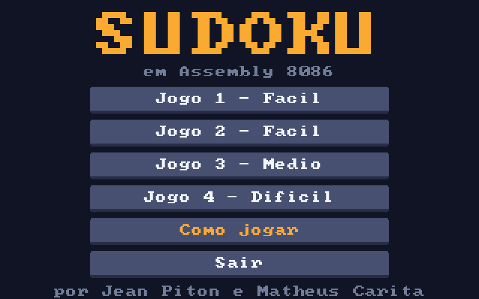
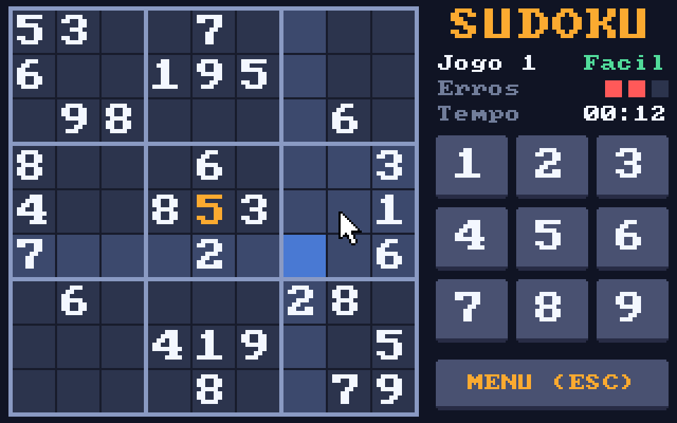
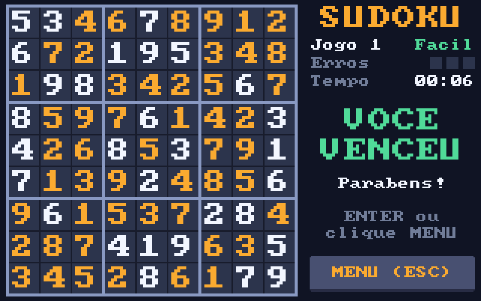

# Sudoku em Assembly 8086

Jogo de Sudoku feito em Assembly 8086 para DOS, com interface gráfica VGA (320x200),
mouse e teclado.





## Como jogar

Complete o tabuleiro 9x9 com números de 1 a 9 sem repetir nenhum número na mesma linha,
na mesma coluna ou no mesmo quadrado 3x3.

- **Número certo** fica no tabuleiro (em laranja; os números do jogo ficam em branco).
- **Número errado** pisca em vermelho e conta um erro. **Com 3 erros você perde** e o
  tabuleiro mostra a resposta.
- Preencha todas as casas para vencer.

| Ação | Mouse | Teclado |
|---|---|---|
| Escolher a casa | clique na casa | setas (dão a volta nas bordas) |
| Jogar um número | clique no número do painel | `1` a `9` |
| Voltar ao menu | botão **MENU** | `ESC` |
| No menu | clique no jogo | `1` a `4`, `C` = como jogar, `ESC` = sair |

A interface ajuda a pensar: a linha, a coluna e o quadrado da casa selecionada ficam
destacados, as casas com o mesmo número da selecionada também, e o número que já foi
colocado nas 9 casas fica apagado no painel. Há um cronômetro e um contador de erros.

São 4 jogos: os dois originais (fáceis), um médio e um difícil, todos com solução única
(conferida por um resolvedor nos testes).



## Como rodar

1. Instale o [DOSBox](https://www.dosbox.com/) (ou DOSBox-X).
2. No DOSBox:
   ```
   mount c C:\caminho\para\Sudoku
   c:
   cd bin
   SUDOKU
   ```

## Montando a partir do código

Sintaxe MASM, só instruções do 8086. Deixe `fonte8x8.inc` na mesma pasta.

```
jwasm -mz Sudoku.asm               (JWasm / UASM, gera o .EXE direto)
masm Sudoku.asm;   link Sudoku.obj;
tasm Sudoku.asm    tlink Sudoku.obj
```

## O que foi corrigido em relação à versão original

- **Dava para vencer sem jogar**: digitar o número certo de uma casa que já vinha
  preenchida contava como acerto. Repetindo isso 51 vezes, aparecia "Você venceu!".
  Agora só casas vazias aceitam números e a vitória é contada pelas casas que faltam.
- **Escrita fora da memória do jogo**: linha `0`, letras ou outros caracteres viravam
  índices inválidos, e o programa lia e podia gravar fora das matrizes. Agora a seleção
  é feita por setas ou clique e nunca sai do tabuleiro.
- **Jogar de novo continuava a partida anterior**: o tabuleiro original era alterado,
  então depois de vencer ou perder o jogo voltava pela metade. Agora cada partida copia
  o tabuleiro e começa do zero.
- **`pushreg`/`popreg` restauravam os registradores trocados** (a ordem dos `POP` era a
  mesma dos `PUSH`), e `IMPRIME_SUDOKU` usava `DI` sem salvar.
- As instruções falavam em coordenadas "de a até i", mas o jogo pedia números, e o
  tabuleiro não mostrava a numeração das linhas e colunas.
- Faltava `.STACK`; as quebras de linha só com `LF` saíam "em escada" no DOSBox; o menu
  oferecia "3 Sair" ao lado de só dois jogos; não havia como sair no meio de uma partida.

## Testes

`testes/testa_sudoku.py` roda o `.EXE` num emulador 8086 (Unicorn) com DOS, BIOS e mouse
simulados, joga partidas inteiras clicando nas casas e nos botões (e pelo teclado) e
confere o resultado lendo a memória de vídeo. Cobre vitória nos 4 jogos, derrota com 3
erros, o exploit antigo, reinício da partida, setas, menu e tela de regras.

```
pip install unicorn pillow
python3 testes/testa_sudoku.py
```

---
Feito por: Jean Okabe Rezende Piton || Matheus Zanon Caritá
